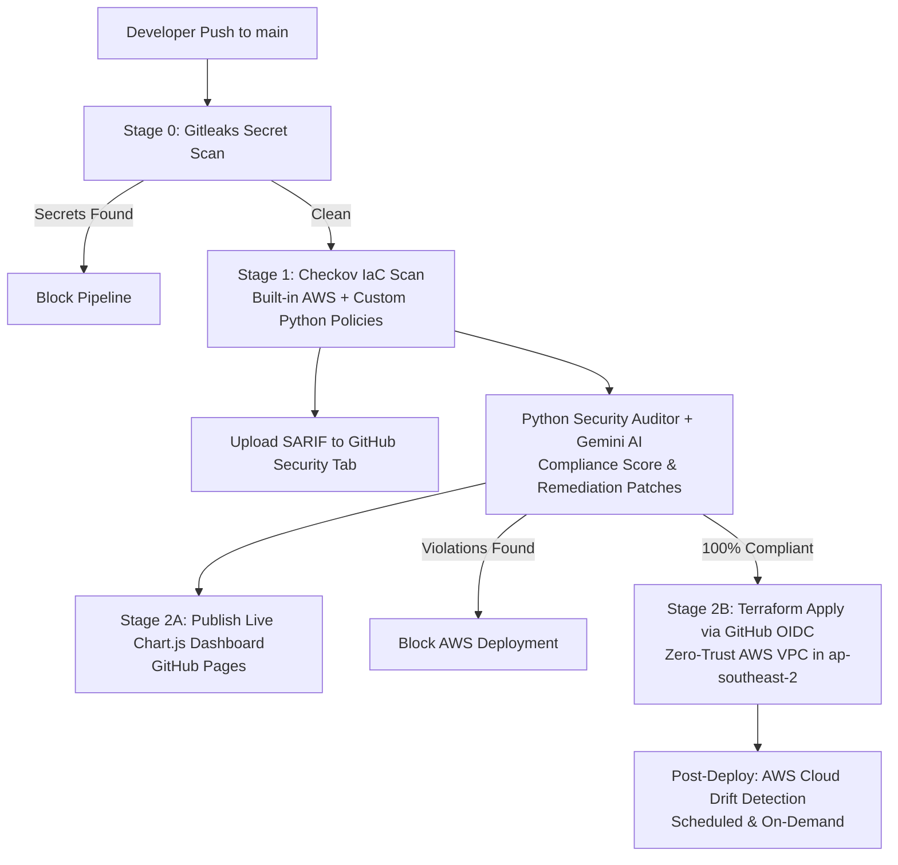

# Automated Cloud Security Pipeline

[](https://github.com/somesh-sharma07/Automated-Cloud-Security-Pipeline/actions/workflows/main.yml)
[](https://github.com/somesh-sharma07/Automated-Cloud-Security-Pipeline/actions/workflows/drift.yml)
[](https://somesh-sharma07.github.io/Automated-Cloud-Security-Pipeline/)

A production-grade, **Shift-Left DevSecOps** and **Policy-as-Code** pipeline that automates secret scanning, infrastructure security auditing, AI-driven remediation, passwordless AWS provisioning, and post-deployment drift detection for a **Zero-Trust AWS VPC** in Sydney (`ap-southeast-2`).

**Live Security Audit Dashboard:** [https://somesh-sharma07.github.io/Automated-Cloud-Security-Pipeline/](https://somesh-sharma07.github.io/Automated-Cloud-Security-Pipeline/)

---

## Architecture & Pipeline Flow



---

## Defense-in-Depth Security Lifecycle

| Phase | Tooling | What It Enforces |
| :--- | :--- | :--- |
| **0. Pre-Scan (Code Hygiene)** | **Gitleaks** | Scans repository files and full Git history for accidentally hardcoded API keys, AWS credentials, or tokens. |
| **1. Shift-Left IaC Gate** | **Checkov + Custom Python** | Evaluates Terraform HCL against CIS/AWS security benchmarks plus custom organizational policies before deployment. |
| **2. Native Alerting** | **GitHub Code Scanning (SARIF)** | Uploads Checkov SARIF reports directly into the repository's **Security → Code scanning** tab. |
| **3. AI Remediation & Reporting** | **Python + Google Gemini API** | Calculates a 0–100% compliance score, generates exact Terraform fix patches on failure (or executive verification on pass), and builds a live **Chart.js** dashboard. |
| **4. Passwordless Provisioning** | **Terraform + GitHub OIDC + S3** | Deploys segmented Zero-Trust AWS infrastructure using short-lived OIDC tokens—zero static `AWS_ACCESS_KEY_ID` secrets stored. |
| **5. Post-Deploy Monitoring** | **AWS Cloud Drift Detection** | Runs `terraform plan -detailed-exitcode` daily (and on demand) to catch unauthorized manual AWS Console edits (ClickOps). |

---

## Custom Policy-as-Code (Python)

In addition to Checkov's built-in AWS checks, this repository enforces custom organizational governance rules written in Python (`custom_policies/`):

* **`CKV_CUSTOM_1` (Data Residency Region Lock):** Verifies that the AWS Terraform provider is strictly locked to the approved `ap-southeast-2` (Sydney) region to prevent unauthorized cross-region deployments.
* **`CKV_CUSTOM_2` (Mandatory FinOps & Ownership Tagging):** Blocks any core AWS network resource (VPC, Subnets, Internet Gateway, Route Tables, Security Groups) missing mandatory `Owner` and `Environment` tags to eliminate Shadow IT and enable cost tracking.

---

## Zero-Trust AWS Infrastructure (`main.tf`)

* **VPC & Network Segmentation:** Isolated public (`10.0.1.0/24`) and private (`10.0.2.0/24`) subnets with public IP auto-assignment disabled by default (`CKV_AWS_130`).
* **Default Security Group Lockdown:** Explicitly restricts the VPC default security group to zero ingress and zero egress (`CKV2_AWS_12`).
* **Least-Privilege Tiered Security Groups:**
  * **Web Tier SG:** Permits encrypted HTTPS (`443`) ingress only and restricts egress strictly to the Database Tier SG on port `3306`.
  * **Database Tier SG:** Rejects all public internet traffic, accepting MySQL (`3306`) connections exclusively from the Web Tier SG.

---

## Repository Structure

```text
.
├── .github/
│   └── workflows/
│       ├── main.yml                  # 4-Stage DevSecOps Pipeline (Gitleaks -> Checkov/SARIF/AI -> Pages -> Terraform)
│       ├── drift.yml                 # Scheduled & On-Demand AWS Cloud Drift Detection
│       └── destroy.yml               # One-Click Manual AWS Teardown
├── custom_policies/
│   ├── region_lock.py                # CKV_CUSTOM_1: Enforce ap-southeast-2 region
│   └── mandatory_tags.py             # CKV_CUSTOM_2: Enforce Owner & Environment tags
├── scripts/
│   └── security_auditor.py           # Parses Checkov JSON, calls Gemini API, generates Chart.js HTML dashboard
├── main.tf                           # Zero-Trust AWS VPC & Security Groups + S3 Remote State
└── README.md
```